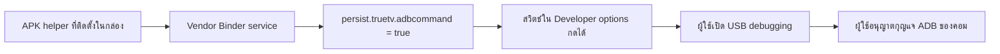

# จากกล่อง TrueID ที่เปิด debugging ไม่ได้ สู่ Home ใหม่ที่ยังดูทีวีและ HBO ได้

กล่อง Android TV เก่าบนโต๊ะยังเปิดดูทีวีได้ แต่การใช้งานเริ่มเหนื่อย จะเปิดอะไรสักอย่างก็ช้า บางครั้งเข้า Live TV แล้วยังเจอโฆษณาอีก สิ่งที่อยากทำจึงดูตรงไปตรงมา: ลดของที่ไม่จำเป็น แล้วเปลี่ยนหน้า Home ให้สะอาดและเบาลง

ผมเจอโปรเจกต์ [cleanyourtv](https://github.com/Gathin23/cleanyourtv) ซึ่งมีทั้งแนวทาง debloat และ launcher หน้าตาเรียบแบบ Apple TV อยู่แล้ว ไม่จำเป็นต้องเขียน launcher ใหม่ทั้งตัว ปัญหาคือขั้นแรกของคู่มือยังผ่านไม่ได้เลย: **เปิด Developer options ได้ แต่ USB debugging เป็นสีเทา กดไม่ได้**

บทความนี้เล่าวิธีไล่หาสาเหตุบนกล่องของผมเอง รวมถึงทางตันที่เจอ วิธีที่ใช้ได้จริง และส่วนที่ยังเป็น workaround ซอร์สของเครื่องมืออยู่ใน repo นี้ ถ้าจะให้ Claude Code หรือ Codex ทำตาม เริ่มที่ [prompt ภาษาไทย](../PROMPT.th.md) และ [คู่มือสำหรับ agent](../docs/agent-runbook.md)

## ก่อนอ่าน: เราทดลองกับอะไร

กล่องคือ **TrueID Skyworth HPH07 หรือ Skyworth Generation 1** ใช้ Android 9, SDK 28, firmware `P2.2.0_20231207`, security patch 5 ธันวาคม 2023 และ kernel `4.9.116_hi3798mv2x` แอป TrueID ที่ตรวจเป็นรุ่น `25.02.21.22`

การทดลองนี้ไม่ได้ root ไม่แฟลช firmware ไม่แก้ DRM provisioning และไม่ factory reset ผลที่ได้ไม่ได้แปลว่ากล่องชื่อคล้ายกันหรือใช้ชิปรุ่นเดียวกันจะทำได้ตามนี้ทั้งหมด

อีกอย่างที่ต้องแยกตั้งแต่ต้น: ปลด debugging, ทำให้ ADB ไม่หลุดระหว่างทำงาน และเปลี่ยน Home เป็น **สามปัญหาคนละชั้น** การแก้ชั้นหนึ่งไม่ได้รับประกันว่าอีกสองชั้นจะหายไปด้วย

## ประตูแรก: จะทำอะไรได้ ถ้า ADB ยังเข้าไม่ได้

ตอนเริ่ม เรามีเพียงรีโมท หน้า Settings และ Play Store เวอร์ชันทีวี พยายามลง X-plore แล้วพบอาการ Installing หมุนสักพัก จากนั้นกลับมาปุ่ม Install หรือขึ้นข้อความติดตั้งไม่ได้ ทั้งที่พื้นที่ว่างยังเหลือ

ความรู้สึกตอนนั้นคือกล่องอาจห้ามลงแอปทั้งหมด แต่ข้อความผิดพลาดทั่วไปยังพิสูจน์ไม่ได้ สุดท้ายบางแอปติดตั้งได้ รวมถึง Downloader และแอปที่ build เอง ส่วน HBO Max จาก Play Store ก็ติดตั้งได้ในช่วงท้าย เราไม่ได้หาสาเหตุเฉพาะของ X-plore จนยืนยัน จึงไม่ควรเขียนว่าแก้ปัญหาตัวติดตั้งครบแล้ว

ทางที่ใช้ต่อได้คือ build APK เล็ก ๆ บน Mac แล้วให้กล่องดาวน์โหลดจากเว็บเซิร์ฟเวอร์ใน LAN ปัญหาถัดไปคือบาง browser ถามว่าจะดาวน์โหลดไหม พอกดแล้วไฟล์หายเงียบ ไม่มี installer เปิดตามมา การดาวน์โหลดสำเร็จกับการติดตั้งสำเร็จเป็นคนละสถานะ ต้องหา download view ของ browser หรือใช้ flow ของ Downloader ให้เปิด APK ได้จริง

เรายังจับคู่กับ Android TV Remote protocol เพื่อส่งปุ่มจากคอม วิธีนี้ช่วยลดการกดรีโมทด้วยมือ แต่ไม่ได้ให้สิทธิ์ shell และไม่ได้ให้ภาพหน้าจอ การส่งตัวอักษรบางหน้าก็ไม่ทำงาน ทั้งที่เลขเข้าได้ จึงต้องแยกปัญหา input method ออกจากการเชื่อมต่อเครือข่าย

เมื่อแอปที่เขียนเองเปิดได้ เราจึงมีจุดยืนแรกสำหรับอ่านข้อมูลที่แอปธรรมดาเข้าถึงได้ และใช้ Android MediaProjection ขอแชร์จออย่างชัดเจนจากผู้ใช้ แทนการขอให้ถ่ายรูปทีวีทุกครั้ง

## อ่านโค้ดก่อนเดาว่าเป็น backdoor

เราอ้างอิงแนวทางวิเคราะห์ APK จาก [REA](https://github.com/morluto/rea) และใช้ JADX แบบ CLI ตรวจ APK ที่ดึงจากเครื่องจริง REA ไม่ใช่ปุ่มเจาะกล่องผ่านเครือข่าย มันช่วยเรื่องวิธีวิเคราะห์ ส่วนเส้นทางที่ใช้ได้ต้องหาจาก firmware และแอปบนกล่องนี้

JADX มีรายละเอียดเล็ก ๆ ที่ทำให้หลงทางได้: การรัน JAR ตรง ๆ ในชุดที่ใช้เปิด GUI โดยปริยาย ถ้าต้องการ CLI ให้เรียก entry point `jadx.cli.JadxCLI` ชัดเจน การ decompile แอปขนาดใหญ่ทั้งตัวก็กินหน่วยความจำมาก เราจึงตรวจทีละ DEX และทีละคลาสตามสิ่งที่กำลังหา

ผลสำคัญอยู่ใน Settings: `DevelopmentFragment.onResume()` เปิดให้กดสวิตช์ USB debugging ก็ต่อเมื่อ property ชื่อ

```text
persist.truetv.adbcommand
```

มีค่าเป็นข้อความ `true` เท่านั้น ค่าเดิมของกล่องว่าง จึงมีเหตุผลตรงจากโค้ดว่าทำไมสวิตช์เป็นสีเทา การเปลี่ยน MTP เป็น PTP หรือเสียบสาย USB อย่างเดียวไม่ไปแก้เงื่อนไขนี้

เราเคยลอง protected broadcast ที่ดูเหมือนใช้เปิดประตูนี้ แต่ระบบปฏิเสธ ดังนั้นวิธีที่สำเร็จ **ไม่ใช่การส่ง broadcast นั้น**

## เส้นทางที่สำเร็จ: vendor service กับการตรวจ caller

กล่องมี service ของผู้ผลิตชื่อ `TrueDmpSystemService` ซึ่งเปิด Binder API สำหรับงานระบบ รวมถึงอ่านและเขียน property

เมื่อไล่ดูการตรวจสิทธิ์ พบว่าตัว service รับ extra `show_build_type` ตอน bind มาใช้กับ flag ตรวจ API และในเส้นทาง debug มีข้อยกเว้นที่ตรวจชื่อ process ว่ามีข้อความของแอป TrueID อยู่ภายใน ชื่อ process ส่วนตัวเป็นสิ่งที่แอปกำหนดใน manifest ได้ จึงไม่ใช่หลักฐานยืนยันตัวตนที่แข็งแรงเท่าการตรวจ UID หรือ signature

แอป helper ของเราจึงใช้ process ส่วนตัวที่ตรงกับเงื่อนไขดังกล่าว bind service ด้วยค่า debug แล้วขอ utility Binder เพื่ออ่าน property ก่อน จากนั้นเปลี่ยน **เฉพาะ property ที่ล็อกสวิตช์** เป็น `true` และอ่านกลับตรวจสอบ



ผลบนเครื่องจริงคือสวิตช์กดได้ เกิดหน้าต่างอนุญาต ADB จากคอม และคำสั่ง `id` ตอบเป็น uid 2000 หรือ `shell` เรายังไม่ได้ root

หลังใช้ API แล้ว เราคืน flag ชั่วคราวของ vendor service เป็น release ส่วน property ที่ปลดสวิตช์ยังเก็บไว้ให้เจ้าของใช้เมนูได้ การคืน flag กับการคืน property เป็นคนละเรื่อง และไม่ได้เปลี่ยน `ro.debuggable` ของระบบ

ซอร์ส helper ใน repo จำกัดเส้นทางนี้ไว้ที่ HPH07 / Android 9 ไม่มีเมนูเขียน system property อะไรก็ได้ ผู้ใช้ควรอ่านค่าของตัวเองก่อน และไม่ใช้ปุ่มคืนค่าว่างถ้าค่าเดิมไม่ใช่ค่าว่าง

## เปิด ADB ได้แล้ว ทำไมกลับ Home มันหายอีก

ตอนแรกดูเหมือนปลดล็อกสำเร็จแล้ว แต่กลับหน้า TrueID แล้ว ADB หลุดอีก ตรวจพบว่า `adb_enabled` กลับเป็น 0 ทั้งที่ property ที่ปลดเมนูยังเป็น `true`

นี่คือชั้นที่สอง: แอป TrueID มีตรรกะเปิด/ปิด ADB ของตัวเอง โดยรับเงื่อนไขจาก configuration แล้วสั่งงานผ่าน privileged OTT gateway ไม่ได้อาศัยแค่สวิตช์ใน Settings

เราเคยทดลองถอน `WRITE_SECURE_SETTINGS` จากแอป TrueID ตัวหลักแล้ว cold-start อีกครั้ง ตัวช่วยยังพบว่าระบบปิด ADB จึงคืน permission ทันที การทดลองนั้นยืนยันว่าถอนสิทธิ์จากแอปหลักอย่างเดียวไม่พอ ส่วน gateway ใช้ shared UID 1000 ของระบบ การถอนสิทธิ์จากตรงนั้นจะกระทบ identity ของระบบร่วมด้วย จึงไม่ได้ทำ

ทางออกที่ใช้งานได้ระหว่างซ่อมบำรุงคือ helper ที่เจ้าของเปิดเอง มีปุ่ม **Enable ADB (6-hour session)** และ **Disable ADB and stop session** ภายในใช้ foreground service กับ ContentObserver คอยรับการเปลี่ยน `adb_enabled` แทนการ polling

ถ้า vendor ปิด ADB ระหว่าง session มันจะเปิดกลับ แต่จำกัดจำนวนการแก้ต่อหนึ่งนาทีเพื่อไม่วนสู้กับระบบไม่สิ้นสุด ไม่มี boot receiver และไม่เปิด maintenance เองเมื่อบูต หมดเวลาหรือกด Stop คือหยุด observer; ถ้าต้องการปิดพอร์ตด้วย ให้ใช้ Disable หรือปิด debugging ใน Settings แล้วตรวจพอร์ต

**เราไม่ได้ลบนโยบายปิด ADB ถาวร** การเรียกสิ่งนี้ว่า workaround ที่ผู้ใช้ควบคุมได้ตรงกับผลมากกว่า และเป็นข้อจำกัดที่ต้องบอกคนทำตาม

## Launcher ใหม่หายไปเอง ไม่ใช่ติดตั้งไม่สำเร็จ

เมื่อเข้าถึง ADB ได้ เรา build launcher จาก cleanyourtv แล้วติดตั้ง มันเปิดได้และหน้าตาตรงที่ต้องการ แต่ภายหลัง package หายไปจริง

ตรวจโค้ด TrueID พบงานที่ query แอปซึ่งประกาศ MAIN/HOME แล้วสั่ง silent uninstall แอปที่ไม่ใช่ system/updated-system โดยมีข้อยกเว้นบางรายการ งานนี้ถูกตั้งเวลาไว้หลังเริ่ม SDK ประมาณ 30 วินาที

นั่นอธิบายว่าทำไมการติดตั้งผ่านแล้วไม่ได้หมายความว่าจะอยู่รอดหลังเปิด stock app ทางแก้ของเราคือ helper แบบรันครั้งเดียว ตั้ง package-manager uninstall block เฉพาะ `com.gathin.tvhome` พร้อมบันทึกค่าเดิม false ไว้สำหรับ restore ไม่ใช่ตั้งข้อห้ามถอนแอปทั้งเครื่อง และไม่ได้เขียน service คอยติดตั้งใหม่เรื่อย ๆ

ทดสอบโดย cold-start TrueID รอเกินเวลาล้าง แล้วตรวจว่า launcher ยังติดตั้งอยู่ จากนั้น reboot ตรวจอีกครั้ง ค่าป้องกันและ package ยังอยู่

## `set-home-activity` บอก Success แต่ Home ยังไม่เปลี่ยน

ยังมีอีกชั้นหนึ่ง: HOME intent ของ TrueID มี priority 2 ส่วน launcher ธรรมดาอยู่ที่ 0 ใน Android 9 การเลือก activity พิจารณาความต่างของ priority ก่อนเส้นทาง preferred activity และแอปทั่วไปไม่ได้ยก priority เหนือระบบได้ตามใจ ดูพฤติกรรมนี้ได้จาก [PackageManagerService ของ AOSP Android 9](https://android.googlesource.com/platform/frameworks/base/+/android-9.0.0_r30/services/core/java/com/android/server/pm/PackageManagerService.java)

คำสั่งพิมพ์ Success จึงเป็นเพียงผลของคำสั่ง ไม่ใช่หลักฐานว่าปุ่มจริงจะเข้าแอปที่ต้องการ

เราใช้ `HomeKeyService` ที่ cleanyourtv มีอยู่แล้ว กำหนด `KEYCODE_HOME:com.gathin.tvhome` เพื่อให้ปุ่ม Home เปิด launcher ใหม่ ไม่ได้เขียน launcher หรือระบบ remap ขึ้นมาใหม่ทั้งชุด และยังเก็บแอป TrueID ไว้ เพราะมันเป็นทั้ง Home เดิมและแอปดู Live TV

เจ้าของกด Home บนรีโมทจริงแล้วเข้า launcher ใหม่ได้ ภาพและ foreground activity ตรงกัน จากนั้นทดสอบเพิ่มเสียงค้าง เสียงยังไล่ต่อเนื่องได้ ซึ่งเป็นจุดสำคัญเพราะ accessibility key filter บางเครื่องทำให้ key repeat เสียได้

ตอนบูตเครื่องอาจยังเข้า TrueID ก่อน กด Home แล้วจึงเป็น launcher ใหม่ เราไม่ควรเขียนว่าเปลี่ยน native default หรือเปิดเครื่องเข้า Home ใหม่ตรง ๆ ได้สมบูรณ์

## Debloat แบบที่ไม่ทำให้ Live TV และ DRM หาย

ก่อนเปลี่ยน package เราเก็บรายการ package, disabled packages, `getprop` และ settings ทั้ง global/secure/system พร้อม ledger ค่าเดิมไว้ การ backup เต็มผ่าน ADB เกิดหลังปลด property แล้ว จึงต้องจดค่า property เดิมแยกตั้งแต่ก่อนแก้

สุดท้ายปิดเพียงสองตัว:

```text
com.google.android.feedback
com.google.android.tv.bugreportsender
```

ทั้งคู่เป็นบริการ feedback/รายงานปัญหาที่ตรวจ components แล้ว ใช้ `pm disable-user --user 0` ทีละ package ไม่ถอน system app ทดลอง restore สองตัวนี้แล้วตรวจว่า disabled list ตรงกับก่อนแก้ จากนั้นใช้รายการเดิมอีกครั้ง และ reboot ตรวจว่าค่าไม่เด้งกลับ

นี่อาจดูน้อยกว่ารายการ debloat ยาว ๆ แต่ฟังก์ชันโฆษณา/คอนเทนต์หลายอย่างอยู่ในแอปเดียวกับ Live TV การปิดทั้ง package เพื่อให้รายชื่อสะอาดจะแลกกับสิ่งที่เจ้าของยังใช้อยู่

อีกเรื่องที่ต้องซื่อสัตย์กับตัวเลขคือกล่องรายงาน RAM ประมาณ 2 GB ไม่ใช่ 1 GB ที่เดาตอนแรก และบริการรายงานสองตัวไม่ได้ทำงานใน snapshot ที่วัด เราจึงไม่มีหลักฐานว่าปิดสองตัวแล้ว CPU หรือ RAM ดีขึ้นทันที ประโยชน์ที่เห็นชัดคือได้หน้า Home ที่เบาและเรียบขึ้น ส่วนความช้าหรือโฆษณาภายใน TrueID ยังเป็นอีกปัญหาหนึ่ง

## ภาพดำไม่ได้แปลว่า DRM เสีย

การแชร์จอช่วยได้มาก แต่เกิดปัญหาซ้ำสองแบบ แบบแรกเป็นบั๊กของ Bridge เอง: callback ทิ้ง frame ที่มาถี่กว่า throttle พอ frame สุดท้ายถูกทิ้งแล้วหน้าจอหยุดนิ่ง ภาพที่ส่งให้คอมจึงค้างอยู่กับ frame เก่า แก้โดยนัดอ่าน latest image หลังครบช่วง throttle แทนการทิ้ง frame สุดท้าย แล้วเทียบภาพที่นิ่งแล้วกับ ADB screenshot

แบบที่สองคือหน้าต่างหรือ video surface ที่ป้องกันการ capture ซึ่งอาจให้ภาพดำหรือ screenshot ว่าง Android มี [MediaProjection ที่ต้องได้รับความยินยอม](https://developer.android.com/media/grow/media-projection) และ [ข้อจำกัดการอ่านหน้าจอ](https://source.android.com/docs/core/permissions/restricted-screen-reading) การที่คอมเห็นดำจึงไม่พิสูจน์ว่าคนที่ทีวีเห็นดำด้วย

เราเริ่มจะทดสอบ Netflix แต่เจ้าของไม่มีสมาชิก จึงเปลี่ยนไป HBO Max ติดตั้งจาก Play Store และให้เจ้าของลองเนื้อหาจริง เจ้าของยืนยันว่ามีทั้งภาพและเสียงหลังเปลี่ยน launcher, debloat และ reboot ส่วน Live TV ก็เห็นภาพ Thai PBS เปลี่ยนจริง

ผลนี้ยืนยันเส้นทางเล่นที่ลอง ไม่ได้พิสูจน์ Widevine level, ความละเอียด 4K, HDR หรือความเข้ากันได้ทุกบริการ และเราไม่ได้ดึงหรือแก้กุญแจ DRM

## ปิดงานให้กลับมาเป็นกล่องดูทีวี

ตอนจบหยุด maintenance service กดยกเลิก USB debugging authorizations ในเมนู Android ปิด USB debugging แล้ว reboot จาก Settings หลังกล่องกลับมา บริการรีโมทยังเชื่อมต่อได้ แต่พอร์ต 5555 ตอบ **Connection refused** พอร์ต Bridge ก็ปิด และกด Home กลับ launcher ใหม่ได้อีกครั้ง

เหตุผลที่เน้นคำว่า refused คือ timeout หรือ “No route to host” บน Mac อาจเกิดจากเครือข่ายหรือ Local Network privacy ไม่ใช่หลักฐานว่าปิดพอร์ตแล้ว ADB ที่เปิดไว้เป็น plaintext ไม่ใช่สิ่งที่ควรทิ้งค้างโดยไม่จำเป็น

เราเก็บ property ที่ปลดเมนูและแอปควบคุมไว้ให้เจ้าของใช้ในอนาคต พร้อมทางคืนค่า ไม่มี maintenance ที่เปิดเองตอน boot ซอร์สที่แจกแยกจากโฟลเดอร์ทำงานจริง โดยไม่ใส่บัญชี token private keys raw screenshots หรือ APK ของผู้ผลิตเข้า Git

## ถ้าจะให้ AI ทำตาม

อ่านเรื่องนี้เพื่อเข้าใจเหตุผลก่อน แล้วให้ agent ใช้ [AGENTS.md](../AGENTS.md), [runbook](../docs/agent-runbook.md) และ [setup guide](../docs/setup.md) เป็นลำดับปฏิบัติ ขั้นที่ต้องให้คนช่วยจริงคือ pairing/consent, ปุ่มรีโมทจริง และการยืนยันภาพกับเสียงบนจอเมื่อ DRM บัง capture ส่วนคำสั่ง สำรองข้อมูล build และตรวจผลควรให้ agent ทำต่อเนื่องได้

แยก checkpoint ส่วนตัวไว้ใน `.state/` เพื่อให้เปลี่ยน context หรือเปลี่ยน agent แล้วไม่ต้องเดาว่าทำอะไรไป การค้นเจอ property ไม่ใช่ปลดสำเร็จ การติดตั้ง launcher ไม่ใช่ Home ทำงาน และเปิดแอปหนังได้ไม่ใช่ DRM ผ่าน ทุกขั้นต้องมีผลที่ใช้ยืนยันมันเอง

รายละเอียดผลที่ทดสอบจริงกับส่วนที่ปรับเพิ่มเพื่อแจกอยู่ใน [validation](../docs/validation.md) โค้ดสาธารณะ build และทดสอบ offline ได้ แต่เราไม่ได้เปิด ADB กลับไปลงเวอร์ชันที่จัดแพ็กใหม่บนกล่องซ้ำเพียงเพื่อทำให้คำอธิบายดูครบ ใครทดสอบบน firmware อื่น ควรบันทึกผลใหม่ของตัวเอง
